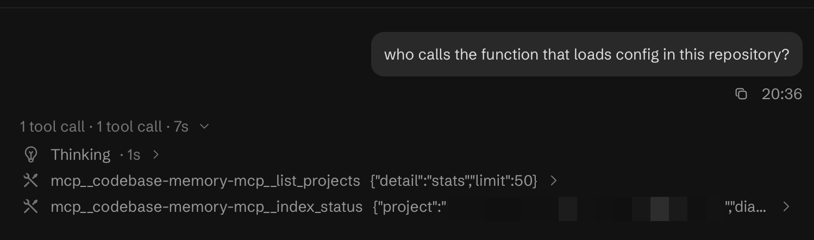

# Codebase Memory

A Kimi Code plugin that puts a codebase knowledge graph in front of the agent, keeps the
per-prompt nudge at ~58 ms instead of ~2.1 s, and notices credential access instead of
blocking it by default (reduced safety). Block-only behavior is available with
`SECRET_GUARD_MODE=strict`.

Three pieces, one install:

| Component | What it is |
| --- | --- |
| **Graph** | The [codebase-memory-mcp](https://github.com/DeusData/codebase-memory-mcp) knowledge graph as an MCP server, plus the system-prompt rules, skill and commands that keep the agent using it |
| **Nudge** | `bin/cbm_nudge`, a ~58 ms C `UserPromptSubmit` hook that reminds the agent to query the graph on structure questions |
| **Guard** | `bin/secret_guard`, a C `PreToolUse` hook that notices credential reads and plaintext provider keys by default (`SECRET_GUARD_MODE=strict` restores blocking), with a `redact` filter for the cases where a value must be inspected |

## What the install line means

When the plugin installs, Kimi Code prints:

```
codebase-memory · Local · 1 skill · 1 MCP server · 2 hooks · 4 commands
```

Four pieces of furniture in one room:

| Piece | In plain words | In this plugin |
| --- | --- | --- |
| **1 skill** | a recipe card taped to the fridge: the agent reads it before it starts cooking | "look in the graph first, not in the cabinets" |
| **1 MCP server** | a pantry with an index-card box: somebody else holds the ingredients | the code graph — symbols, callers, imports, impact |
| **2 hooks** | two doorbells the house rings by itself | *bell 1:* a prompt arrives → remind about the graph. *bell 2:* a tool is about to run → check it for secrets |
| **4 commands** | the four buttons you press yourself | `/status` · `/index` `/reindex` · `/audit-secrets` |

Nothing else is installed: no daemon, no background service, no `node_modules`. `Local` only
means it came from a folder or zip on this machine instead of from a marketplace entry (`Curated`)
or from Kimi's own catalog (`Official`).

## Try it — copy one line, paste it into a new session

```text
# paste any one of these into a fresh session
who calls the function that loads config in this repository?
where is the request size limit enforced?
what are the entry points here, and which module owns the graph?
```

If the answers arrive as `trace_path` / `search_graph` output instead of grep hits, the skill and
the MCP server are wired correctly. If they arrive as file listings, the skill did not load — check
`/plugins info codebase-memory`.



Evidence from a real session (v0.2.6, one tool call each, 7 s total): the prompt went to
`list_projects`, then `index_status`. No file listing, no grep.

## How it works, in one picture

```
                        one turn, two hooks

  your prompt ──► cbm_nudge ─────► one reminder in context (structure questions only)
                     ~58 ms             no network, no daemon, no model call
                       │
                       ▼
                   model thinks
                       │
                       ▼  tool call
              ┌──────────────────┐
              │  secret_guard    │◄── inspects the *call*, never the tool result
              │  (PreToolUse)    │
              └───┬──────────┬───────────────┐
 credential path or│          │nothing suspicious
 a key inside the  │          │
 call              │          │
             ┌─────▼──┐  ┌────▼──────────────┐  ┌─────────────────────────┐
             │  deny  │  │ the tool runs     │  │ reduced (default):      │
             │ exit 2 │  │ graph / file / …  │  │ notice + allow (exit 0) │
             └────────┘  └───────────────────┘  └─────────────────────────┘
             (strict: SECRET_GUARD_MODE=strict)
```

**Why two hooks instead of a proxy:** Kimi Code already owns the loop. The plugin only
answers two questions the loop asks anyway — *"should I remind the model about the graph?"*
and *"may this tool call run?"* — in ~60 ms of C, with no daemon to crash and no network
hop to time out.

### The three jobs

| Job | File | Trigger | Cost | Verdict |
| --- | --- | --- | --- | --- |
| Graph | `codebase-memory-mcp` from `PATH` (MCP `graph`) | every graph tool call | upstream server | symbols, callers, impact — instead of grepping |
| Nudge | `c/cbm_nudge.c` | `UserPromptSubmit` | ~58 ms | one short reminder, or silence |
| Guard | `c/secret_guard.c` | `PreToolUse` | ~60 ms | exit 0 notice + allow (reduced default) or exit 2 + a reason (strict) |

### What a blocked call looks like (strict mode only)

```
secret_guard: blocked credential-path (tool=Read)
{"hookSpecificOutput":{"permissionDecision":"deny",
 "permissionDecisionReason":"Blocked: credential or private-key path. …"}}
```

In reduced mode (the default) nothing is blocked: the call runs and a one-line notice goes to
stderr and to `$KIMI_CODE_HOME/logs/secret-guard.log`:

```
secret_guard (reduced safety): credential-path found in a Read call — the call is allowed, not
blocked. Safety is reduced: rotate the value, or pipe text through secret_guard redact to
inspect it without leaking.
```

### Footprint

| Platform | `cbm_nudge` | `secret_guard` | release tarball |
| --- | --- | --- | --- |
| macOS x86_64 | 17.7 KB | 31.1 KB | 74.3 KB |
| macOS arm64 | 51.0 KB | 52.1 KB | 75.1 KB |
| Linux x86_64 | 17.2 KB | 42.8 KB | 78.9 KB |
| Linux arm64 | 71.8 KB | 72.8 KB | 80.0 KB |

Both hooks are C11 with no third-party code. `strip -x` saves under 2%, so releases ship
with symbols on purpose — a crash backtrace stays readable. The full four-platform plugin
zip is 145 KB.

## 1. The graph

The plugin registers the upstream MCP server as `graph` (stdio, command `codebase-memory-mcp`,
resolved from `PATH` — MCP servers are spawned without a shell, so a bundled `.sh` would never
start on Windows; `bin/codebase-memory-mcp.sh` remains for launches with a minimal `PATH`, point
`~/.kimi-code/mcp.json` at it if you need that). Around it:

- `SYSTEM.md` — the discovery rules: graph for structure, text search for literals, the
  session-start checklist, and the traps that make graph answers wrong.
- `skills/using-codebase-memory/` — the same workflow as a skill, loaded at session start.
- `commands/` — `/codebase-memory:status`, `/codebase-memory:index`,
  `/codebase-memory:reindex`, `/codebase-memory:audit-secrets`.

The plugin ships the tools and the workflow, not an index. Index each repository you work in:

```sh
# index the repository you are in, once, and keep the graph on disk
codebase-memory-mcp cli index_repository --repo-path . --mode moderate --persistence true
```

or run `/codebase-memory:index` inside a session. Index the repository, not a whole
workspace containing it: a workspace-wide index can exceed the per-process memory budget.

## 2. The nudge (~58 ms)

`bin/cbm_nudge` (`c/cbm_nudge.c`) runs on every `UserPromptSubmit`. It reads the hook
payload, and when the prompt asks about code structure — "who calls", "call chain",
"architecture", "dead code", "impact", and similar phrases — prints a short reminder to use
`search_graph` / `trace_path` before grepping. Otherwise it prints nothing.

It replaces `codebase-memory-mcp hook-augment --dialect kimi`, which the upstream installer
adds to `~/.kimi-code/config.toml`:

| | upstream hook | `cbm_nudge` |
| --- | --- | --- |
| Cost per prompt | 2.08–2.13 s | ~58 ms |
| Output | none | the reminder, on structure questions |

Measured over 200 runs against a `/usr/bin/true` spawn baseline. The upstream hook stays
silent because the kimi-code payload carries the prompt as an **array of content blocks**
(`"prompt":[{"type":"text","text":"…"}]`), not a string; `cbm_nudge` parses that shape. If it
cannot parse a payload it logs the payload's **key names only** — never values — to
`$KIMI_CODE_HOME/logs/cbm-nudge.log` and exits 0.

## 3. The secret guard

`bin/secret_guard` (`c/secret_guard.c`) runs on every `PreToolUse`. By default it runs in **reduced**
mode: when it detects a credential path or a secret-shaped value it prints a friendly one-line
notice, logs `NOTICE reduced <rule> tool=<tool>` (paths only, never values), and exits 0 so the
call runs. Safety is reduced — rotate the value, or pipe text through `secret_guard redact` to
inspect it without leaking.

Set `SECRET_GUARD_MODE=strict` to restore the old behavior: exit 2 with a deny decision that
blocks the call. It covers:

- **Credential paths** — `.env` and `.env.*` (except `.env.example`, `.env.sample`,
  `.env.template`, `.env.dist`), `~/.ssh/`, `~/.aws/`, `~/.gnupg/`, `~/.kube/`,
  `~/.docker/config.json`, `~/.config/gh/`, `~/.kimi-code/credentials/`,
  `~/.kimi-code/config.toml`, `~/.codex/auth.json`, `~/.cargo/credentials`,
  `~/.m2/settings.xml`, `.npmrc`, `.netrc`, `.git-credentials`, `id_rsa` and friends,
  `credentials.*`, `secrets.*`, `service-account*.json`, and key-store extensions such as
  `.pem`, `.p12`, `.pfx`, `.jks`, `.keystore`, `.kdbx`, `.gpg`, `.ovpn`.
- **Secret values** — provider key prefixes (43 of them, listed in
  [SECURITY.md](SECURITY.md)), PEM private-key blocks, JWTs, `Bearer` tokens, passwords
  embedded in URLs, and `name = value` pairs whose name is `password`, `api_key`, `token`,
  `secret`, `client_secret` and similar — when the value is long and mixed enough to be real.
- **Shell commands** — `cat`, `less`, `head`, `cp`, `curl`, `strings` and similar readers on a
  credential path; `grep`/`rg`/`sed`/`awk` on a credential path, unless the command is a
  count or presence check (`grep -c`, `grep -l`, `grep -q`).

Deliberately allowed: writing a file (the `Write` tool is not path-checked), `.env.example`
style templates, `grep -c`/`-l`/`-q` on a credential path, placeholder values
(`your_api_key_here`), environment references (`$TOKEN`, `process.env.X`), short or
single-character-class values, and any command piped through the redactor.

**Redact instead of reading raw.** `redact` reads text on stdin and replaces every detected
secret with `[REDACTED:<label>]`, always exiting 0:

```sh
# show a credential file with every secret masked
PLUGIN=~/.kimi-code/plugins/managed/codebase-memory
cat ~/.kimi-code/config.toml | "$PLUGIN/bin/run" secret_guard redact
```

A command containing `| … redact` is allowed through the guard, so this is the supported way
to inspect a credential file's shape without copying its values.

**Log.** Every block (strict) or notice (reduced default) appends one line — the rule and the tool name, never the value — to `$KIMI_CODE_HOME/logs/secret-guard.log` (fallback `~/.kimi-code/logs/secret-guard.log`).

**Turning it off.** There is no disable variable in 0.2.0. Disable the plugin in `/plugins`.
The full threat model and the exact rule classes are in [SECURITY.md](SECURITY.md).

### Remembering a key that already leaked

Prefix matching only knows shapes. For a key that leaked once, register its **fingerprint** —
40 bits of SHA-256, 10 hex chars, never the key itself:

```sh
# remember the keys that already leaked: fingerprints only, never plaintext
PLUGIN=~/.kimi-code/plugins/managed/codebase-memory
R=~/.kimi-code/secret-fingerprints.txt
cat ~/.kimi-code/config.toml | "$PLUGIN/bin/run" secret_guard fingerprint --secrets > "$R"
```

`PLUGIN` is the installed plugin, not your working directory: `./bin/run` only resolves when the
shell's cwd is the plugin root, which is true for a hook and false for you. From a checkout, set
`PLUGIN=<checkout>` instead.

From then on, any tool call carrying that value is noticed as `known-secret` (reduced default) or denied as `known-secret` (strict), and `redact` masks it, even if the provider changes the key format. `--secrets` restricts the output to values the pattern rules already flag, so a URL or a model id in the same file is not registered. At 40 bits a collision needs ~1.5M registered values; a registry of hundreds is nowhere near it. The registry is transparent — see "Transparency & contribution" in [SECURITY.md](SECURITY.md) for what it does and does not prevent, how to audit it, and how to change the 40-bit width.

### Self-check, every 10th run

Both hooks count their own allocations and frees. A clean sampled run appends one line to
`$KIMI_CODE_HOME/logs/<tool>.runs.log`:

```
selfcheck ok allocs=3 frees=3 version=0.2.3 darwin-x86_64
```

If a run ends with memory still live, it prints one line naming live/allocs/frees, the version,
the platform and the issue URL — for the guard as a hook `message` (so it shows in the session),
for the nudge as plain text — and the same line goes to the log. Paste that line into an issue and
the count is enough to reproduce.

Leak audit 2026-11-01 with macOS `leaks --atExit`: seven paths (allow, credential-path block,
registry hit, `redact`, `fingerprint`, malformed payload, 1 MB input) → 0 leaks each. ASan is not
usable for this on macOS: Apple clang prints `detect_leaks is not supported on this platform`.

## Install

```text
# from GitHub
/plugins install https://github.com/thiensubs/kimi-plugin-codebase-memory

# or from a local checkout
/plugins install /path/to/kimi-plugin-codebase-memory
```

Then `/reload` or start a new session — plugin changes do not apply to a running session.
Local installs are copied to `$KIMI_CODE_HOME/plugins/managed/<id>/` and run from there, so
editing the source directory afterwards has no effect until you reinstall.

If you previously ran the upstream `codebase-memory-mcp install --clients=kimi`, remove its
`UserPromptSubmit` hook from `~/.kimi-code/config.toml` and its MCP entry from
`$KIMI_CODE_HOME/mcp.json`, or you pay for two hooks and register two servers.

## Requirements

| Requirement | Detail |
| --- | --- |
| kimi-code | 2.4 or newer (plugin-declared hooks, `PreToolUse` blocking) |
| `codebase-memory-mcp` | 0.12.1 or newer on `PATH` — install it from https://github.com/DeusData/codebase-memory-mcp, then confirm with `codebase-memory-mcp --version` |
| C compiler | Only when no prebuilt matches the platform: `cc` or `clang` on `PATH` (or `CC=/path/to/cc`). Compiles once, ~1 s |

If the binary lives outside `PATH`, set `CBM_BIN` for the Kimi Code process; the launcher
checks `CBM_BIN`, `PATH`, `~/.local/bin`, `~/.cargo/bin`, Homebrew and `/usr/local/bin`.

## Platform support

`bin/run` picks the binary by `uname -sm`:

| Platform | `uname -sm` | Prebuilt directory | In this repository | If missing |
| --- | --- | --- | --- | --- |
| macOS Apple Silicon | `Darwin arm64` | `bin/prebuilt/darwin-arm64/` | yes | — |
| macOS Intel | `Darwin x86_64` | `bin/prebuilt/darwin-x86_64/` | yes | — |
| Linux x86_64 | `Linux x86_64` | `bin/prebuilt/linux-x86_64/` | release archive | compile once into the cache |
| Linux arm64 | `Linux aarch64` | `bin/prebuilt/linux-arm64/` | release archive | compile once into the cache |
| Windows x86_64 | `cmd.exe` | `bin/prebuilt/windows-x86_64/` | release archive | hooks exit 0 and do nothing |
| anything else | — | — | no | hooks exit 0 and do nothing |

The macOS binaries (~150 KB for both architectures) are committed so a fresh install needs
no compiler and no network beyond the plugin download. Linux binaries need a Linux libc at
link time, so they are built and tested by `.github/workflows/release.yml` on Linux runners
and shipped in the release archive; without one, the dispatcher compiles the tool once into
`${XDG_CACHE_HOME:-~/.cache}/kimi-plugin-codebase-memory/<os>-<arch>/` and reuses it.

## Configuration

| Variable | Used by | Effect |
| --- | --- | --- |
| `KIMI_CODE_HOME` | all hooks | Set by Kimi Code. Log directory; falls back to `~/.kimi-code` |
| `KIMI_PLUGIN_ROOT` | all plugin hooks | Set by Kimi Code. Not required: `bin/run` resolves the plugin root from its own path |
| `XDG_CACHE_HOME` | `bin/run` | Where the fallback compile is cached; defaults to `~/.cache` |
| `CBM_BIN` | `bin/codebase-memory-mcp.sh` | Absolute path to the upstream binary when it is not on `PATH` |
| `CBM_MEM_BUDGET_MB` | upstream server | Indexing memory budget, default 512 MB. Export it before launching Kimi Code |
| `CC` | `bin/run`, `build-c.sh` | Compiler for the fallback build |
| `CBM_NUDGE_DUMP` | `bin/cbm_nudge` | Writes the last hook payload to `$KIMI_CODE_HOME/logs/cbm-nudge-payload.json` for debugging |
| `SECRET_GUARD_DISABLE` | — | Not implemented. To stop the guard entirely, disable the plugin with `/plugins disable codebase-memory` |
| `SECRET_GUARD_MODE` | `secret_guard` hook | `strict` restores block-on-secret (exit 2). Anything else, or unset, runs reduced mode: notice + allow |

## Troubleshooting

| Symptom | Cause and fix |
| --- | --- |
| Graph tools missing from the session | Run `/reload`; check `/plugins info codebase-memory`. If the server logs `codebase-memory-mcp not found`, install it or set `CBM_BIN` |
| Hooks do nothing at all | Check `$KIMI_CODE_HOME/logs/*.log` for a `run` line: unsupported platform, no compiler, or compile failure. Every failure is fail-open |
| First prompt after install is slow | The fallback compile runs once (~1 s) and is cached; later prompts use the cached binary |
| Nudge stays silent on a structure question | It only fires on its keyword list; confirm the hook runs with `CBM_NUDGE_DUMP=1` and read the payload log |
| Guard blocks a command you know is safe | Read the rule in `secret-guard.log`, then use `grep -c`, pipe through `secret_guard redact`, set `SECRET_GUARD_MODE=strict` to block instead of notice, or disable the plugin |
| Index job fails with `over_memory_budget` | Index the sub-repository, not the workspace root; raise `CBM_MEM_BUDGET_MB` and restart the server |
| Graph answers look stale | `/codebase-memory:status`, then `/codebase-memory:reindex` for the repository that owns the files |

## License

MIT. The graph tool is [DeusData/codebase-memory-mcp](https://github.com/DeusData/codebase-memory-mcp),
also MIT.
